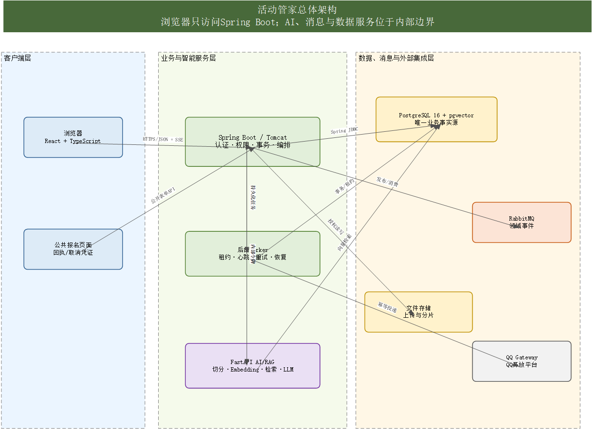
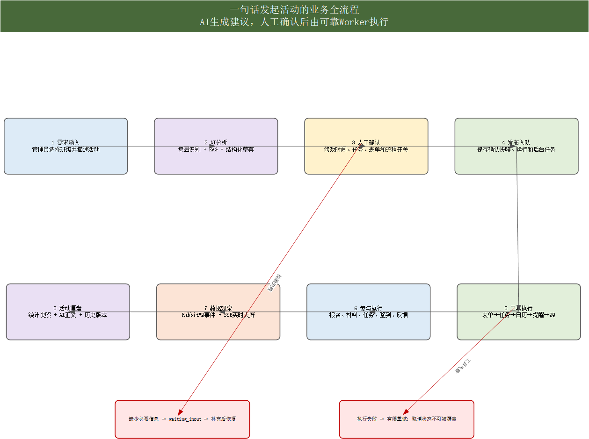
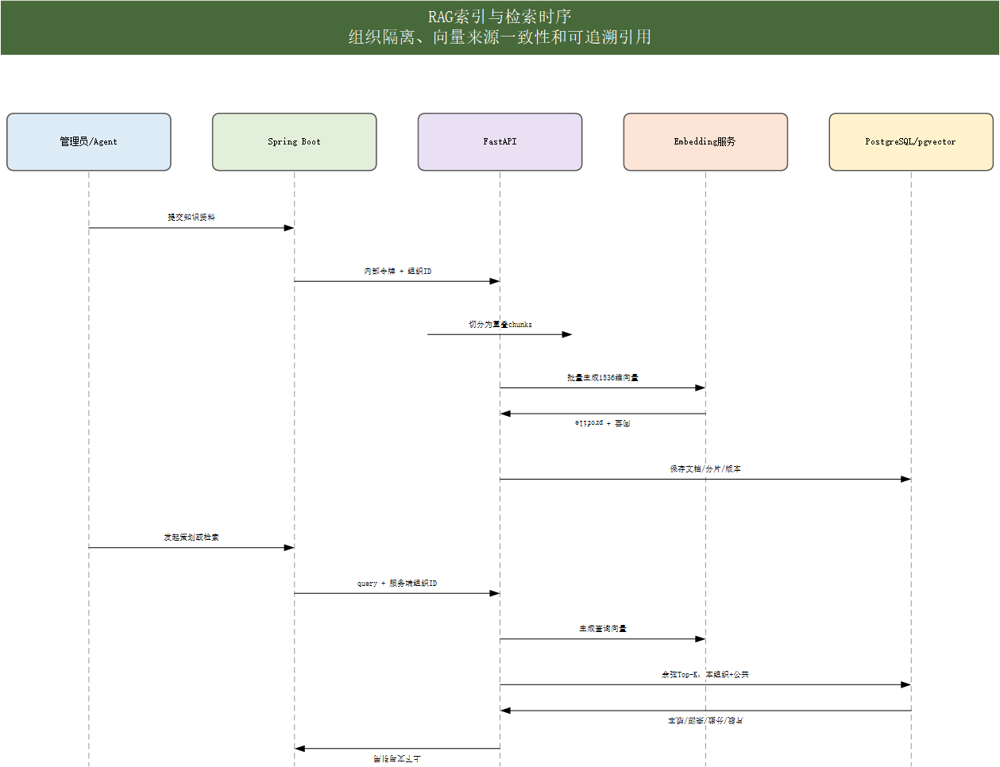
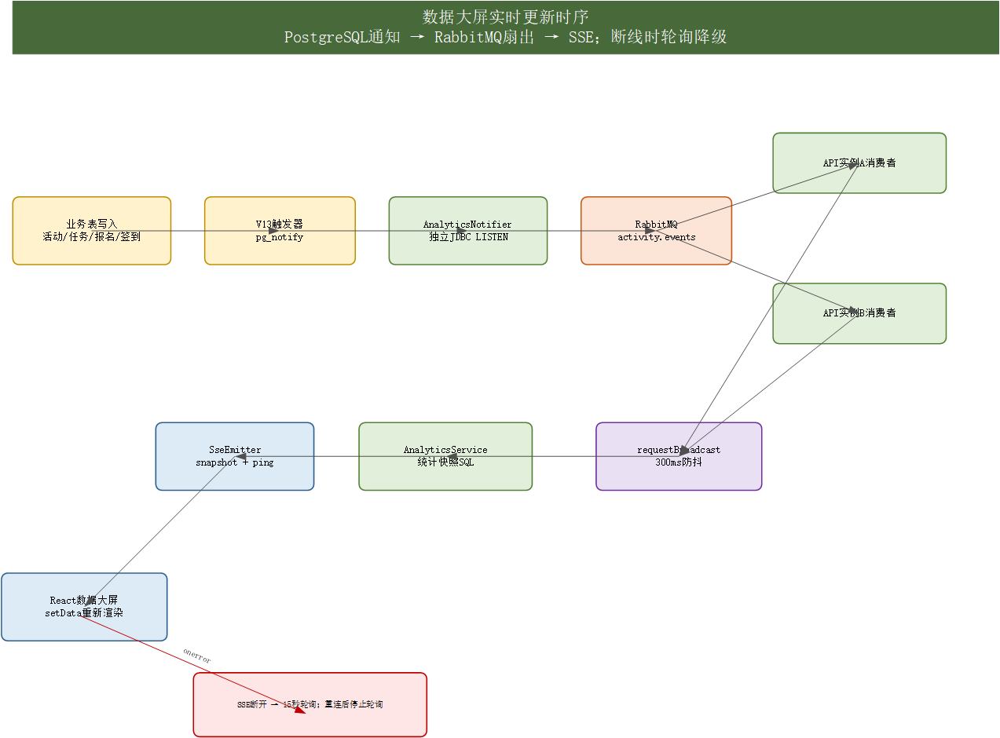
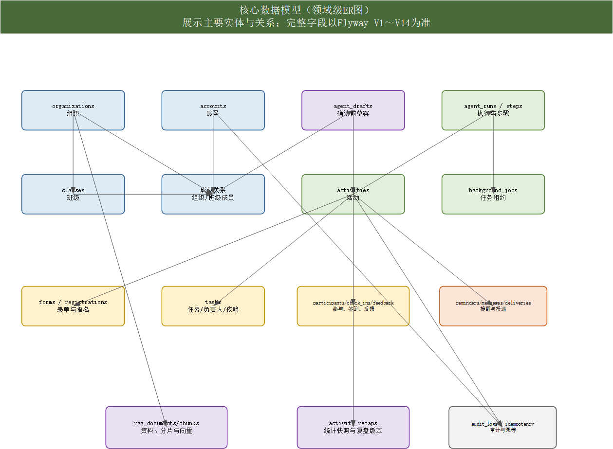
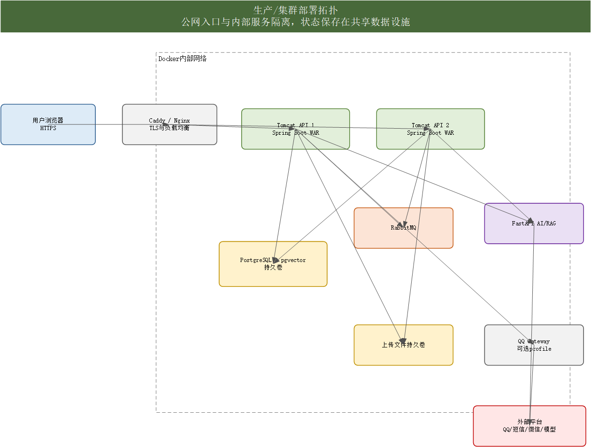

# 活动管家系统设计说明书

> 项目：高校社团/班级活动组织 AI 助手（活动管家）  
> 文档版本：1.0  
> 编制日期：2026-11-22  
> 适用代码：Sailor-Moon 当前 `main` 工作区（含 RabbitMQ、SSE 与 RAG 最新改动）

## 1. 文档目的

本文档说明活动管家的系统边界、总体架构、模块职责、数据结构、关键流程、接口、安全、并发可靠性和部署方案，供课程设计评审、团队开发、测试验收和后续维护使用。本文以仓库当前代码和 Flyway V1～V14 为准；外部平台是否可用仍取决于实际凭据与授权。

系统面向高校班级与社团活动组织场景，将“策划、报名、分工、提醒、群通知、签到、反馈、复盘”组织成一条可确认、可恢复、可审计的业务链路。AI 只生成结构化建议，最终权限判断、业务写入和外部工具调用由 Spring Boot 负责。

## 2. 建设目标与范围

### 2.1 建设目标

- 管理员用自然语言发起活动、作业、通知或信息收集任务。
- 系统生成可人工修改的结构化草案，确认后再执行。
- 自动创建报名表、活动任务、日历、提醒和消息投递记录。
- 参与者完成报名、任务、材料提交、签到和反馈。
- 管理员通过实时数据大屏观察活动、报名、任务和参与效果。
- 活动结束后生成带统计快照和来源信息的复盘。
- 通过 RAG 检索组织知识库，为策划和问答提供依据。

### 2.2 系统边界

系统内部包含 React Web、Spring Boot 业务后端、FastAPI AI/RAG 服务、PostgreSQL/pgvector、RabbitMQ 和可选 QQ Gateway。短信、微信、QQ 开放平台及大模型/Embedding 服务属于外部系统。未配置外部凭据时，核心站内业务应继续工作，并明确显示降级状态。

## 3. 用户角色与权限

| 角色 | 主要能力 | 权限边界 |
|---|---|---|
| 管理员 | 组织/班级管理、成员导入、草案确认、活动管理、统计、知识库和模板 | 仅操作所属组织及有管理权限的班级 |
| 参与者 | 查看本人任务、提交材料、签到、反馈 | 仅访问本人或授权活动数据 |
| 公共报名者 | 通过公开表单报名、查询或取消本人报名 | 使用回执/取消凭证，不可读取完整名单 |
| 系统服务 | 后台任务、提醒、AI调用、消息投递、审计 | 使用内部令牌，不具备浏览器用户身份 |

授权遵循“登录身份 → 组织归属 → 班级归属 → 资源归属”的逐层校验。模型返回的姓名、账号或资源编号不能直接授予权限。

## 4. 总体架构



系统采用前后端分离开发、同源部署的多服务架构：

1. React 18 + TypeScript + Vite 负责页面、表单、图表和 SSE 事件接收。
2. Spring Boot 3.5 / Java 21 是唯一公网业务入口，负责认证授权、事务、业务规则、任务编排、审计和外部工具调用。
3. FastAPI 是仅限内部访问的 AI/RAG 服务，负责文档切分、Embedding、向量检索、结构化策划和复盘生成。
4. PostgreSQL 16 是唯一业务事实源；pgvector 保存文档向量；Flyway 管理数据库结构版本。
5. RabbitMQ 发布后端领域事件；当前用于实时数据大屏的跨实例刷新通知。
6. SSE 保持服务器到浏览器的单向长连接，用于数据大屏和站内通知实时更新。
7. QQ Gateway 负责 QQ 平台长连接与消息发送，Spring Boot 仍负责业务权限和幂等。

## 5. 模块设计

### 5.1 React Web

- 登录与初始化：账号密码、可选手机号/微信登录、首次组织初始化。
- 工作台：草案、活动、任务、通知和快捷入口。
- Agent 草案：自然语言输入、结构化草案编辑、人工确认发布。
- 活动管理：活动状态、表单、任务、运行步骤、提醒和投递结果。
- 成员与班级：Excel 模板、批量导入、密码重置和群绑定。
- 知识库：资料增删改查、检索结果和版本来源展示。
- 数据大屏：指标、趋势、状态、参与效果和异常提醒；通过 SSE 实时更新。

### 5.2 Spring Boot 业务后端

- `api`：HTTP/SSE 控制器与请求响应契约。
- `security`：会话认证、安全过滤、密码哈希和访问控制。
- `service`：活动、班级、任务、报名、签到、反馈、文件、模板、复盘和知识库业务。
- `orchestration`：Agent运行协议、步骤日志、工具编排和恢复。
- `integration`：FastAPI 与 QQ Gateway 客户端。
- `persistence`：Spring JDBC 数据访问、主从读路由和事务。
- `config`：应用、登录方式、RabbitMQ和安全配置。

普通业务使用 Spring JDBC 与 HikariCP；PostgreSQL `LISTEN/NOTIFY` 使用独立原生 JDBC 长连接，避免长期占用业务连接池连接。

### 5.3 FastAPI AI/RAG

- `main.py`：内部 API、令牌校验和请求编排。
- `models.py`：Pydantic 请求、响应和字段约束。
- `chunker.py`：句子边界优先的重叠窗口切分。
- `embeddings.py`：远程 Embedding 与本地哈希降级。
- `rag.py`：组织隔离的 pgvector 写入和检索。
- `llm.py`：DeepSeek/OpenAI兼容模型调用与确定性离线降级。

### 5.4 RabbitMQ与SSE

- `RabbitEventConfig` 声明持久化主题交换机 `activity.events`。
- 每个 Spring Boot 实例建立独占、自动删除的临时队列并绑定 `analytics.#`。
- `AnalyticsEventPublisher` 发布 `analytics.changed`；RabbitMQ不可用时降级为本实例广播。
- `AnalyticsEventConsumer` 消费事件并调用 `requestBroadcast()`。
- `AnalyticsStreamService` 在300ms窗口内合并重复事件，再通过 SSE 推送快照。
- SSE 每30秒发送轻量心跳，不重复执行完整统计查询。

## 6. 活动业务流程



1. 管理员选择班级并输入自然语言需求。
2. Spring Boot 校验身份和班级权限，调用 FastAPI 分析需求。
3. FastAPI结合RAG资料返回结构化草案；不可用时返回离线规则建议。
4. 管理员修改标题、时间、任务、表单和流程开关并确认发布。
5. Spring Boot保存确认快照，创建活动、运行记录和后台任务。
6. Worker按固定工具集合执行表单、任务、日历、提醒和QQ投递。
7. 参与者报名、执行任务、提交材料、签到和反馈。
8. 数据变化通过RabbitMQ和SSE更新数据大屏。
9. 管理员结束活动并生成复盘；复盘保存统计快照、正文、版本和生成信息。

发布采用“先确认、后执行”。缺少必要时间或人员信息时进入 `waiting_input`，不得由模型臆造字段。失败步骤按规则有限重试，取消状态不能被重试覆盖。

## 7. RAG设计



### 7.1 索引流程

```text
资料正文 → 参数校验 → 文档切分 → 批量Embedding
       → 维度/来源校验 → pgvector持久化 → 返回索引状态
```

切分算法优先在窗口后半段寻找最靠右的句子结束符，避免机械截断；相邻分片保留可配置重叠区域，以减少跨片语义丢失。Embedding维度固定为1536，并记录 `embedding_profile`，避免不同模型向量被静默混用。

### 7.2 检索流程

Spring Boot从登录身份确定 `organization_id`，而不是信任浏览器传入组织。FastAPI生成查询向量后，在“当前组织资料＋公共资料”中执行余弦距离检索，返回Top-K片段、分数、来源和版本。结构化草案保存生成时的来源快照，后续资料更新不改写历史草案依据。

### 7.3 降级策略

- 未配置远程Embedding：使用本地哈希向量，仅供开发验证。
- 模型不可用：使用确定性离线规则生成基础建议。
- RAG不可用：标记 `retrieval_status=unavailable`，不伪造引用。

## 8. 实时数据大屏设计



1. 浏览器通过 `/analytics/stream` 建立带会话Cookie的SSE连接。
2. `AnalyticsStreamService`保存账号、周期和班级过滤条件，并立即推送初始快照。
3. 业务表发生写入时，V13触发器执行 `pg_notify('analytics_changed', table_name)`。
4. `AnalyticsNotifier`通过独立JDBC连接接收通知，并向RabbitMQ发布事件。
5. 每个API实例的消费者都收到事件，使该实例上的SSE客户端均能更新。
6. 300ms防抖把突发写入合并成一次统计和广播。
7. SSE断开时前端退化为15秒轮询，重连后停止轮询。

当前广播会按订阅逐一计算快照；后续可按“组织＋班级＋周期”分组复用查询结果，以提升高并发效率。

## 9. 数据设计



### 9.1 核心数据域

| 数据域 | 主要表 | 说明 |
|---|---|---|
| 身份与权限 | `accounts`、`auth_sessions`、`organizations`、`classes`、成员关系表 | 登录、会话、组织及班级隔离 |
| Agent执行 | `agent_drafts`、`agent_runs`、`background_jobs`、`steps` | 确认快照、运行状态、任务租约和步骤日志 |
| 活动协作 | `activities`、`forms`、`registrations`、`tasks`、依赖/负责人关系 | 活动、报名、任务与状态版本 |
| 提醒与投递 | `reminders`、`messages`、`outbound_deliveries`、`delivery_events` | 定时提醒、站内通知和外部投递事实 |
| 参与和复盘 | `activity_participants`、`activity_check_ins`、`activity_feedback`、`activity_recaps` | 成员快照、签到、反馈和复盘版本 |
| 文件 | `file_assets`、`upload_sessions`、`upload_chunks` | 普通/分片上传、校验和与存储键 |
| RAG | `rag_documents`、`rag_document_chunks` | 资料、分片、向量、来源和版本 |
| 安全审计 | `audit_logs`、`idempotency_keys`、登录限流表 | 审计、幂等和验证码/登录限制 |

### 9.2 一致性策略

- Flyway V1～V14只追加迁移，禁止修改已执行迁移。
- 关键资源使用版本字段实现乐观锁。
- 请求ID、逻辑键和数据库唯一约束共同保证幂等。
- Worker使用租约版本、心跳和截止时间避免多实例重复接管。
- 外部投递保存意图、尝试和结果；未知结果不能盲目重发。
- 组织、班级和账号条件必须出现在服务端查询中。

## 10. 接口设计原则

- 浏览器仅调用Spring Boot业务接口，不直接调用FastAPI、数据库或QQ Gateway。
- API使用JSON；文件上传/下载和SSE按相应媒体类型处理。
- 登录身份来自服务端会话Cookie，敏感资源不接受客户端指定组织作为授权依据。
- FastAPI内部接口要求 `X-Internal-Token`。
- QQ Gateway接口要求独立网关令牌与 `Idempotency-Key`。
- 参数错误返回4xx；服务异常返回受控错误，不向前端泄露密钥、JDBC地址或内部堆栈。

主要接口分组包括 `/auth`、`/account`、`/classes`、`/agent`、`/activities`、`/tasks`、`/forms`、`/participation`、`/knowledge`、`/business-templates`、`/analytics`、`/notifications` 和 `/files`。完整字段契约以 `docs/API.md` 和代码中的请求模型为准。

## 11. 安全设计

- 密码使用带随机盐的慢哈希验证，数据库不保存明文密码。
- 会话令牌仅保存哈希，Cookie设置HttpOnly、SameSite，生产环境启用Secure。
- 登录、短信和微信流程实行频率限制、状态校验和过期清理。
- 管理员重置密码、导入成员和资源修改均复核组织归属。
- 文件下载按账号和任务归属重新授权，存储键不作为公开地址。
- RAG查询执行组织隔离；模型只接收最小必要上下文。
- `.env`、生产密钥、数据库备份和用户文件不进入Git。
- 关键操作写入 `audit_logs`，记录操作者、组织、资源和动作。

## 12. 并发、可靠性与恢复

- 报名容量通过数据库约束、事务与唯一身份键防止超额和重复报名。
- 后台任务使用持久化队列、租约、心跳、有限重试和恢复扫描。
- 活动取消、运行状态和工具步骤分别记录，避免单一状态掩盖真实结果。
- RabbitMQ负责实例间事件分发；SSE负责服务端到浏览器的实时推送。
- 大屏事件使用300ms防抖；RabbitMQ异常时单实例本地广播降级。
- 前端SSE异常时自动轮询；服务端心跳清理失效连接。
- PostgreSQL、上传目录和QQ投递日志纳入备份；恢复必须在隔离项目中验证。

当前RabbitMQ大屏事件属于“缓存失效通知”，不是业务事实。若将QQ、提醒等关键业务迁入消息队列，应补充事务Outbox、Publisher Confirm、死信队列和消费幂等。

## 13. 部署设计



### 13.1 单实例开发

`compose.yml`启动PostgreSQL、RabbitMQ、FastAPI、Spring Boot/Tomcat，并可选启动QQ Gateway。浏览器访问 `http://127.0.0.1:8080`。

### 13.2 双实例演示

`compose.cluster.yml`启动Nginx、两个Tomcat实例、共享PostgreSQL、RabbitMQ和FastAPI。会话和后台任务保存在数据库中；RabbitMQ将实时事件扇出到每个API实例。

### 13.3 生产部署

`compose.prod.yml`由Caddy提供HTTPS入口。数据库、RabbitMQ、AI与网关仅在内部网络通信，生产凭据通过独立环境文件注入，数据与上传文件使用持久卷。

## 14. 测试与质量保证

- Java/Spring：控制器、服务、权限、编排、可靠执行、文件与数据库契约测试。
- FastAPI/AI：切分、Embedding、RAG、鉴权与接口测试。
- React：TypeScript编译和Vite生产构建。
- Compose：配置展开、健康检查和单/双实例集成验证。
- 关键验收：跨组织拒绝、重复请求幂等、容量并发、任务接管、SSE降级、备份恢复。

截至2026-11-21的本地验证记录为Java 268项测试无失败、AI 35项测试通过、前端生产构建通过。测试数量不替代真实QQ、远程模型和生产并发环境的验收。

## 15. 已知限制与演进建议

1. 配置真实Embedding服务并重新索引本地哈希向量资料。
2. 完成PDF/Word/TXT解析后自动切分入库的文件型RAG闭环。
3. 为RabbitMQ生产者、消费者、防抖和多实例SSE增加专项集成测试。
4. 按组织、班级和周期合并相同大屏查询，降低高并发统计开销。
5. 关键异步业务采用事务Outbox、确认、重试、死信和幂等消费。
6. 使用真实QQ、短信、微信和模型凭据完成实网验收。
7. 增加指标、日志聚合、消息积压告警和容量压测。

## 16. Visio图纸清单

可编辑源文件：`docs/diagrams/ActivityAssistant-SystemDesign.vsdx`

| 页码 | Visio页面 | 内容 |
|---:|---|---|
| 1 | 总体架构 | 客户端、业务后端、AI、消息、数据和外部系统边界 |
| 2 | 活动全流程 | 从自然语言需求到复盘的状态流转 |
| 3 | RAG时序 | 索引、检索、组织隔离和生成引用 |
| 4 | 实时大屏 | PostgreSQL通知、RabbitMQ、SSE与前端降级 |
| 5 | 部署拓扑 | HTTPS入口、双实例、内部服务和持久化存储 |
| 6 | 核心数据模型 | 身份、活动、执行、参与、RAG和审计关系 |

Visio各页同时导出PNG并嵌入本文档。调整图形时应修改`.vsdx`源文件后重新导出，不要只修改截图。
